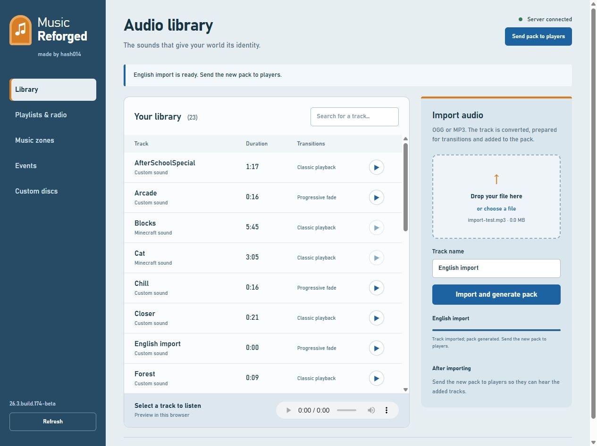

# Music Reforged — made by hash014

A rewrite of Zombie_Striker's Music plugin with radios, playlists, jukeboxes,
custom audio and automatic resource pack generation. Runs on Bukkit/Spigot/Paper servers.
The JAR requires no other plugin, account or paid service.

## Administration, zones and events

Run `/music admin` to open browser administration through a link valid for
30 minutes. A player must remain online and retain administrator permission.
Links issued from the console also work. By default, the interface listens on
`127.0.0.1:8125`, accessible only from the server machine. For remote access,
configure `admin.bind` and `admin.public-url` behind an HTTPS reverse proxy.

The interface supports **OGG and MP3 imports**, browser previews, playlist
reordering, zones, event triggers and custom discs. Install FFmpeg on the server
and make it available in PATH, or set its executable path in `admin.ffmpeg`.
Imported files are converted to mono OGG Vorbis, with their duration detected
automatically. Every successful import rebuilds the pack. Use **Send pack to
players** to offer it to online players, who must accept it.

Imports run in the background with progress reporting. Default limits are
32 MB per file and 600 seconds per track. Tracks exceeding the duration limit
are rejected rather than truncated. Failed conversions do not add incomplete tracks.

```text
/music playlist create Forest
/music playlist add Forest Chill
/music playlist create Combat
/music playlist add Combat Arcade
/music radio Forest
/music radio off
/music zone wand
/music zone create forest Forest
/music trigger set battle COMBAT * Combat 12 80
/music trigger set boss BOSS WITHER Combat 15 100
/music trigger set woods BIOME FOREST Forest 5 40
/music disc create theme Reforged
/music disc give theme MyPlayer
/music disc eject
```

To create a zone in-game, obtain the wand with `/music zone wand`, left-click
the first corner, right-click the second corner, then run `zone create`.
A zone is a rectangular volume with a world and a priority. Zones survive restarts.

Available events are COMBAT, BOSS, BIOME, JOIN, DEATH and RESPAWN.
COMBAT reacts to damage between entities, including player projectiles.
BOSS reacts to a nearby Wither or Ender Dragon and attacks against these bosses.
BIOME maintains the ambience while the biome matches its filter. The highest
priority takes over the zone or radio; normal ambience returns when the trigger
expires. `*` matches everything; filters can use biome or entity names from the server.

Custom discs are Minecraft inventory items associated with a title and track.
Right-click a jukebox while holding a disc to insert it. Look at that jukebox
and run `disc eject` to retrieve it. Jukebox ownership is respected.
Playlists, zones, rules and disc definitions can also be edited in `state.yml`
and `ambiences.yml`, then reloaded with `/music reload`.



## Installation

1. Stop the server and place `Music-Reforged-1.0.0.jar` in `plugins/`.
2. Remove the old `Music.jar` to free the `/music` command. Keep its `plugins/Music/` folder if you need migration.
3. Start the server with the Java version required by that server.
4. The plugin creates `plugins/MusicReforged/`, its catalogue and `pack.zip`.
5. To hear custom tracks, install this pack on the client or configure automatic distribution below.

Cat, Blocks and Stal use built-in Minecraft sounds. The three original loops
Reforged, Chill and Arcade, and the fifteen legacy Music examples, require the audio pack.

## Playback and commands

```text
/music play Reforged 0
/music addToQueue Chill 0
/music addToQueue Arcade 0
```

Place a jukebox while sneaking, then right-click it to select station 0.
The menu also lets you adjust volume, turn off the jukebox and enable worldwide
broadcasting with the relevant permission. `/music` opens the catalogue;
click a track to start personal playback.

```text
/music listSongs [page]
/music listStations [page]
/music listStationSongs <station> [page]
/music removeFromQueue <zero-based index> <station>
/music removeFromStation <track> <station>
/music clearQueue <station>
/music removeStation <station>
/music toggleRandomizeSongs <station>
/music setRadius <station> <blocks>
/music pause <station>
/music resume <station>
/music skip <station>
/music listen <track>
/music playOnce <track>
/music volume <0 to 1>
/music stop
/music getPack
/music box station <station>
/music box volume <0 to 10>
/music box global|local|on|off
/music createSong <name> <namespace:sound> <duration in seconds>
/music reload
/music status
/music author
```

`playOnce` requires administrator permission and plays for all players in the
sender's world, as in Music. `listen` plays for the sender. `setUpStation` remains
an alias for `play`. Enclose names containing spaces in quotation marks, such as
`"My track"`. `clearQueue` retains the station and its owner. Empty playlists are silent.

## Resource pack distribution

For testing on the same machine, set this in `plugins/MusicReforged/config.yml`:

```yaml
resource-pack:
  serve: true
  bind: 127.0.0.1
  port: 8124
  public-url: ''
  send-on-join: true
```

Restart, then run `/music getPack`. The embedded HTTP server serves only `pack.zip`.
For players on other machines, host `pack.zip` at a directly downloadable HTTPS
URL and set `public-url`, or use the embedded HTTP server with `bind: 0.0.0.0`,
an accessible port and a public `public-url`. A localhost URL only works on the
server machine. The default administration server can also serve the pack.

Players must accept the offered pack. The plugin tracks the loading status
reported by the client and sends the SHA-1 when the server API supports it.
It does not automatically merge an existing server pack: merge `assets/` files
and `sounds.json` entries if other plugins also provide a pack.

The format is read from the server's `version.json`; older versions use a
fallback table. Modern formats, starting with 1.21.9, use `min_format` and
`max_format`; 26.3 uses format 97.1. Changing the server version regenerates
the pack at the next startup. With ViaVersion, this pack targets the actual
server version; clients using a different version need additional testing.

## Adding music manually

Encode **mono OGG Vorbis** for positional audio. Example using FFmpeg:

```text
ffmpeg -i song.mp3 -ac 1 -c:a libvorbis -q:a 4 song.ogg
```

Place the file at `plugins/MusicReforged/audio/mysite/song.ogg`, then run:

```text
/music createSong MySong mysite:song 123.45
/music reload
```

`mysite:song` matches the pack entry generated from the file path. Browser import
performs this conversion automatically with FFmpeg; manual addition uses a
prepared OGG file. You can also create `plugins/MusicReforged/Music/MySong.txt`:

```text
Time:123.45
Soundname:mysite:song
```

The legacy `Songname:` field is supported. Durations are decimal seconds,
scheduled with one-tick precision: 50 ms at 20 TPS. The entire pack is limited
to 64 MB, and the configurable default per-file limit is 32 MB. Catalogue errors
reject a reload without replacing the active state.

## Permissions

| Permission | Default | Purpose |
|---|---|---|
| `musicreforged.use` | everyone | Catalogue, listening and personal settings |
| `musicreforged.create` | OP | Create stations |
| `musicreforged.admin` | OP | Manage all stations and jukeboxes, create tracks and reload |
| `musicreforged.global` | OP | Worldwide broadcasting |
| `music.placejukebox` / `music.usejukebox` | everyone | Place and open your radio jukebox |
| `music.changesong` / `music.changevolume` | everyone | Select a station and adjust your jukebox volume |

Legacy permissions `music.admin`, `music.commands`, `music.default`, `music.*`
and `music.changevolumetoglobal` are retained. Stations and jukeboxes have UUID
owners. Other players cannot modify or break someone else's radio jukebox.
Events cancelled by protection plugins are respected.

## Migration

On first startup only, the plugin detects `plugins/Music/config.yml` and imports
`Loop`, `Jukeboxes` and `Music/*.txt` files into its own folder. Imported files
are backed up under `MusicReforged/backups/`; the original folder is unchanged.
The `migration-complete` marker prevents duplicate imports. Locations are stored
as primitive values even when their world is not loaded. Playlists restart from the beginning.

Legacy UUIDs are retained. For owners stored by name, the player cache is used.
If their identity is unknown on an authenticated server, import is explicitly
rejected to preserve ownership. Correct a copy of the configuration using their
UUID. Legacy `r` becomes a radius in blocks multiplied by 16. A legacy volume of
`-1` becomes worldwide broadcasting. Removing a track no longer deletes its entire station.

## Audio behavior

The three original loops and imported tracks use 250 ms segments. The engine
fades the new ambience in and the previous ambience out over `transitions.seconds`
(2 seconds by default). Gain changes between segments without restarting the
entire song. This increases pack size and audio packet traffic. Vanilla sounds
and legacy tracks without segments use classic playback; the browser labels them.
Fade packets and gains have been checked, but the perceptual result still needs
listening in a real Minecraft client.

Zones, event ambiences and personal radio compete by priority. Without an
active ambience, a player receives the closest eligible local radio, then a
global radio from their world. This avoids duplicates and multiple copies of
the same sound stopping each other. The radius excludes out-of-range listeners;
volume accounts for Minecraft attenuation and personal settings. Jukeboxes in
unloaded chunks do not force world loading.

Clients cannot seek within an already started sound. A player who joins, changes
radio or changes volume starts the current track from the beginning and joins
the station's transitions at the next track. On APIs without sound stopping,
sounds already sent must finish naturally. Muting prevents future playback.

## Building and verification

With a recent JDK and Maven, run `mvn clean verify`. On Windows:
`./build.ps1 -JavaHome C:\path\jdk -Maven C:\path\mvn.cmd`.
Bytecode targets Java 8; the server determines its required Java version.
`python tools/bootstrap.py` downloads Maven and test JDKs if needed.
The OGG assets are already included in the sources. FFmpeg is required to
regenerate them with `python tools/make_assets.py` or import new tracks.
Protocol tests also require Node.js: run `npm install --prefix .tools/protocol`
after `bootstrap.py`.

```text
python tools/prepare_servers.py --all
python tools/run_matrix.py --all --workers 4
python tools/test_migration.py
python tools/package_release.py
```

The scripts create disposable worlds under `test-servers/`, bind servers to
`127.0.0.1`, accept the EULA for these authorized tests, verify official downloads
by SHA-256 and stop servers after testing. The protocol client checks packets,
not human audio perception. See [COMPATIBILITY.md](docs/COMPATIBILITY.md) and
the JSON reports for the exact evidence and the English build's regression checks.

Packaging creates the JAR, an installation ZIP and complete source ZIP under
`dist/`, with SHA-256 checksums. It verifies that the JAR matches the successful
runtime report. To package the English build using its regression report:

```text
python tools/package_release.py --report docs/english-matrix-results.json
```

Local test dependencies, worlds and administration sessions are excluded from
the archives. User-defined playlist, zone and track names are preserved; the
plugin's own messages and administration interface are in English.

GPL-2.0-or-later; credits and dependencies are listed in `NOTICE` and `licenses/`.
